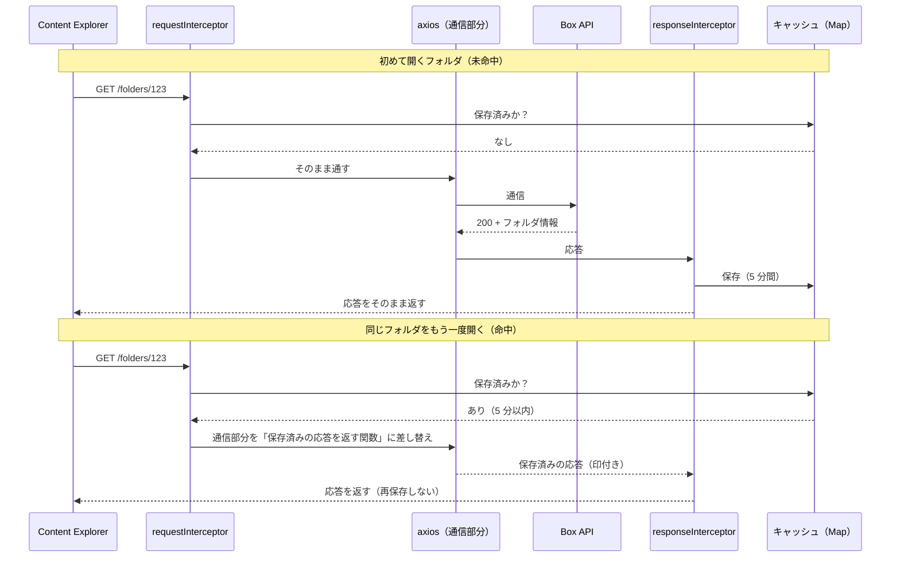

# Box フォルダ取得キャッシュ 設計・仕様書

| 項目 | 内容 |
| --- | --- |
| 対象 | Box Content Explorer のフォルダ取得（`GET /folders/{id}`）の短時間キャッシュ |
| 実装 | `src/lib/boxFolderCache.ts`（本体）、`src/pages/SS.tsx`（組み込み）、`src/main.tsx`（設定） |
| 状態 | 試作として実装。開発環境で、キャッシュの命中を利用者が確認済み。本番での効果と影響は、未測定 |
| 作成日 | 2026-11-06 |
| 関連資料 | [Box API 呼び出し回数の削減対応 報告書](./report-box-api-call-reduction.md)（背景・全体の対策）<br>[SS 画面 技術仕様書](./spec-ss-screen.md)（画面全体） |

## 1. 目的

Box の API 呼び出しには、月間 100,000 回の上限がある。SS 画面に埋め込んでいる Box Content Explorer は、**フォルダを開くたびに、訪問済みのフォルダでも、必ず Box に問い合わせる**。この通信を、設定では減らせない（第 3.1 節）。

そこで、Explorer と Box の間に入る **通信の中継処理** を使い、同じフォルダの取得結果を **5 分間** ブラウザのメモリに保存して、再び開いたときは、通信せずに保存済みの結果を返す。

## 2. 概要



要点は 3 つ。

1. **仕組み**: Box の画面部品が持つ `requestInterceptor` / `responseInterceptor`（axios の中継処理）の差し込み口を使う。Box のコードは改変しない。
2. **命中時**: 要求の設定の `adapter`（axios の通信を行う部分）を差し替え、**通信を行わずに** 保存済みの応答を返す。Box には、リクエストが届かない。
3. **対象**: フォルダ取得（`GET /folders/{id}`）だけ。

## 3. 前提となる仕組み（調査結果）

### 3.1 Box UI Elements の挙動（v23.0.0。`index.html` が CDN から読み込むバージョン）

| 事実 | 出典 |
| --- | --- |
| フォルダの取得（`fetchFolder`）は、`getFolder` に **`forceFetch: true` を固定で渡す**。そのため、訪問済みのフォルダでも、毎回 API を呼ぶ | [`ContentExplorer.tsx`](https://github.com/box/box-ui-elements/blob/v23.0.0/src/elements/content-explorer/ContentExplorer.tsx) 588 行付近 |
| `show()` に渡したオプションは、そのまま画面部品の入力（props）として渡される | [`wrappers/ContentExplorer.js`](https://github.com/box/box-ui-elements/blob/v23.0.0/src/elements/wrappers/ContentExplorer.js) の `render()`（`{...this.options}`） |
| `requestInterceptor` / `responseInterceptor` は、画面部品のコンストラクタで API 層に渡される | `ContentExplorer.tsx` 245〜262 行付近 |
| API 層は、通信に axios を使い、渡された中継処理を `axios.interceptors.request.use(…)` / `response.use(…)` に登録する | [`utils/Xhr.js`](https://github.com/box/box-ui-elements/blob/v23.0.0/src/utils/Xhr.js) 109〜114 行 |
| フォルダ取得の通信は、**1 回の** `GET /folders/{id}?fields=…&sort=…&direction=…&limit=…&offset=…`。フォルダ情報と、中身の一覧（`item_collection`）が、1 つの応答で返る | [`api/Folder.js`](https://github.com/box/box-ui-elements/blob/v23.0.0/src/api/Folder.js) の `folderRequest` |
| 認証は、`Authorization: Bearer {トークン}` ヘッダー | `Xhr.js` の `getHeaders` |
| 通信エラーのときも、`responseInterceptor` が、エラー内容を引数にして呼ばれる | `Xhr.js` の `errorInterceptor` |

### 3.2 axios の仕様（一般的な仕様）

- 要求の設定（`config`）に `adapter`（関数）を指定すると、axios は、通信の代わりに、その関数を呼び、返された応答を使う。
- 中継処理は、「要求側（通信の直前）→ 通信部分 → 応答側」の順に呼ばれる。要求側で `adapter` を差し替えると、通信は行われず、応答側へ進む。

## 4. 設計

### 4.1 構成

| 要素 | ファイル | 役割 |
| --- | --- | --- |
| `createBoxFolderCache(options)` | `src/lib/boxFolderCache.ts` | キャッシュを作る関数。2 つの中継処理と、操作用の関数を返す |
| `boxFolderCache` | 同上 | アプリ全体で共有する 1 つのインスタンス |
| `configureBoxFolderCache` / `isBoxFolderCacheEnabled` | 同上 | 有効・無効と、ログ出力の設定 |
| 組み込み | `src/pages/SS.tsx` | `show()` のオプションに、2 つの中継処理を渡す |
| 設定 | `src/main.tsx` | 起動時に、環境変数から有効・無効を設定する |

### 4.2 保存するデータ

保存先は、モジュール内の `Map<キー, エントリ>` で、ブラウザのメモリ上にある。ページの再読み込みで、全て消える。永続化はしない。

| 項目 | 内容 |
| --- | --- |
| エントリ | `{ savedAt, data, status, statusText }`。応答のうち、画面部品が使う部分だけを保持する（ヘッダー等は保持しない） |
| `savedAt` | 保存した時刻（ミリ秒）。有効時間の判定に使う |
| `data` | 応答の本文（フォルダ情報と、中身の一覧）。**深いコピー** で保存する |

### 4.3 キー

```
{Authorization ヘッダーの値} \0 {URL のパス}?{パラメータを、キー名の順に並べた文字列}
```

| 要素 | 理由 |
| --- | --- |
| `Authorization`（`Bearer …`） | **ユーザー・トークンごとに分離する**。別のユーザーが同じブラウザを使っても、他人の取得結果は返らない。トークンの更新（49 分ごと）で、古いエントリは使われなくなる |
| URL のパス | フォルダごとに分ける |
| パラメータ（並べ替え） | 並び替え（`sort`/`direction`）や、ページ位置（`limit`/`offset`）が違えば、別のエントリにする。順序の違いは、同じキーにする |

- キーは、メモリ内でだけ使う。**ログやイベントには、トークンを含まない形（パスとパラメータだけ）で出す。**

### 4.4 対象の判定（`isFolderRequest`）

次の **すべて** を満たす要求だけが対象。

- メソッドが `GET`（省略時は `GET` とみなす）。
- URL のパス（クエリ・フラグメントを除く）が、`/folders/{ID}` で **終わる**。

| URL | 対象 |
| --- | --- |
| `…/folders/123` | ○ |
| `…/folders/0` | ○ |
| `…/folders/123?fields=…` | ○（クエリは除いて判定） |
| `…/folders/123/items` | × |
| `…/folders/123/collaborations` | × |
| `…/folders`、`…/files/123` | × |
| `POST` など | × |

### 4.5 要求側（`requestInterceptor`）

1. 対象でなければ、何もせず返す。
2. キーを作り、保存済みのエントリを探す。
3. **なし、または期限切れ**（`現在時刻 - savedAt ≥ 有効時間`）: 期限切れのエントリは削除する。未命中として数え、そのまま返す（通信される）。
4. **あり、かつ有効**: 命中として数え、設定の `adapter` を、次の応答を返す関数に差し替える。
   - 本文: 保存済みの `data` の **深いコピー**
   - `status` / `statusText`: 保存時のもの
   - `config`: 渡された設定
   - **印**: `fromBoxFolderCache: true`
5. 設定を返す。

### 4.6 応答側（`responseInterceptor`）

1. **例外を投げない**（Box が通信エラーのときにも、エラー内容を引数にして呼ぶため）。受け取ったものは、そのまま返す。
2. 引数が、オブジェクトでなければ、返す。
3. **`fromBoxFolderCache` の印があれば、保存せずに返す**（キャッシュから返した応答を、また保存すると、保存時刻が更新され、有効時間が延び続けるため）。
4. ステータスが `200` でない、または対象の要求でなければ、保存せずに返す（失敗・認証エラー・非対象は、保存しない）。
5. 保存する。
   - 期限切れのエントリを掃除する。
   - 同じキーを削除してから入れ直す（`Map` の挿入順を、新しい順にするため）。
   - 本文は、深いコピーで保存する。
   - 件数が上限（200）を超えたら、**古いものから** 削除する。
6. 例外が出ても、握りつぶして、応答はそのまま返す（キャッシュの失敗で、通常の通信を妨げない）。

### 4.7 深いコピー

- 保存するときと、返すときの **両方** で、`JSON.parse(JSON.stringify(…))` により、深いコピーを作る。
- 理由: Box のコードが、受け取った応答を書き換えても、保存済みの内容が壊れないようにするため。
- 応答は、JSON 由来の素のデータなので、この方法で、欠落する値はない。

### 4.8 有効時間・容量

| 項目 | 値 | 備考 |
| --- | --- | --- |
| 有効時間 | 300,000 ミリ秒（5 分） | `BOX_FOLDER_CACHE_TTL_MS`。コラボレーター一覧のキャッシュ（`COLLABORATIONS_TTL_MS`）と同じ値 |
| 最大件数 | 200 | `BOX_FOLDER_CACHE_MAX_ENTRIES`。超えたら古いものから削除 |
| 命中しても、有効時間は延びない | | 保存した時刻から、5 分で必ず期限切れになる |
| 期限切れの掃除 | 保存のとき（全エントリが対象）、および命中判定のとき（該当のエントリのみ） | 定期的なタイマーは使わない |

## 5. 画面との接続

### 5.1 `SS.tsx`

Box Content Explorer の `show()` のオプションに、キャッシュが有効なときだけ、2 つの中継処理を足す。

```ts
explorerInstance.show(rootFolderId, accessToken, {
  container: ".box-container",
  ...(isBoxFolderCacheEnabled()
    ? {
        requestInterceptor: boxFolderCache.requestInterceptor,
        responseInterceptor: boxFolderCache.responseInterceptor,
      }
    : {}),
  // …
});
```

- キャッシュ本体は、画面の外（モジュール単位）にある。そのため、SS 画面を離れても、領域を切り替えても、保存済みの内容が残る。再訪（他の画面から戻る、領域の行き来）でも、命中する。
- 領域ごとに、画面部品が作り直されても、中継処理は同じ関数なので、同じキャッシュを使う。

### 5.2 設定（`main.tsx`）

```ts
configureBoxFolderCache({
  enabled: import.meta.env.VITE_BOX_FOLDER_CACHE !== 'false',
  debug: import.meta.env.DEV,
})
```

| 設定 | 値 | 効果 |
| --- | --- | --- |
| `enabled` | 既定 `true`。環境変数 `VITE_BOX_FOLDER_CACHE=false` で無効 | 無効のときは、`show()` に中継処理を渡さない（通常の動作） |
| `debug` | 開発サーバーのときのみ `true` | 命中・未命中・保存を、コンソールに出す |

- 環境変数は、ビルド時（開発サーバーの起動時）に決まる。変更には、再起動が必要。
- `import.meta.env` は、テスト環境（Jest）で使えないため、`main.tsx`（テストされない起動ファイル）で読み、キャッシュ側には、関数の呼び出しで渡す。

### 5.3 更新ボタン（キャッシュの手動破棄）

古い情報（第 7.1 節）を、利用者が自分で解消するためのボタン。**フォルダの表示と、コラボレーター一覧を、まとめて最新にする、1 つのボタン** である。

| 項目 | 内容 |
| --- | --- |
| 場所 | パスバーの左側、「戻る」「進む」の隣（更新マークのアイコン。アクセシビリティ名「最新の情報に更新」、ツールチップ「最新の情報に更新（フォルダの内容・パス・コラボレーター）」） |
| 動作 | ① フォルダ取得のキャッシュ（本書の対象）を **全て破棄** する → ② 現在のフォルダを Box から取り直す（通信は 1 回）→ ③ コラボレーター一覧のキャッシュを **全て破棄** し、一覧が開いていれば、現在のフォルダの一覧を取り直す（通信は 1 回） |
| 通信 | 一覧が畳まれていれば 1 回、開いていれば 2 回 |
| 取り直しの結果 | 現在地の名前とパス（パスバー、パスのコピー、Box Drive のパス）が、最新になる。履歴と、戻る・進むの位置は変わらない |
| 他のフォルダ | キャッシュを全て破棄するため、他のフォルダは、次に開いたときに取得し直す（親のフォルダの古い一覧が残らないようにするため） |
| 復元中 | フォルダの取り直しは、何もしない（ボタンは、復元中は表示されない） |

- ①は、**②より先に** 行う。逆だと、取り直しの要求が、保存済みの古い内容で応答される。
- コラボレーター一覧のキャッシュ（`ssSlice`、5 分）は、本書のキャッシュとは別の場所（Redux）にある。その破棄と取り直しの詳細は、[SS 画面仕様書](./spec-ss-screen.md)の 7.4A を参照する。
- **ボタンを 1 つにまとめた理由**: 利用者の目的は、ほとんどが「今見ている画面を最新にしたい」である。フォルダ用と一覧用に分けると、「フォルダの更新ボタンを押したのに、一覧が古い」という誤解が起きやすく、利用者への説明も長くなる。増える通信は、一覧が開いているときの 1 回だけである。
- 実装: `SS.tsx` の `handleRefreshAll`（`boxFolderCache.clear()` → フックの `handleRefresh()` → `refreshCollaborations()`）、`useBoxExplorer` の `handleRefresh`。

## 6. 振る舞いの一覧

| 状況 | 動作 | Box への通信 |
| --- | --- | --- |
| 初めて開くフォルダ | 通信して、保存する | あり |
| 5 分以内に、同じフォルダを再び開く | 保存済みの結果を返す | **なし** |
| 5 分を過ぎて開く | 期限切れの分を削除し、通信して、保存し直す | あり |
| 並び替えやページ位置を変える | 別のキーなので、通信する | あり |
| 別のユーザー・トークンで開く | 別のキーなので、通信する | あり |
| フォルダ以外の要求（`/items`、`/collaborations` 等） | 保存も命中もしない | あり |
| 通信が失敗（401、404、ネットワークエラー等） | 保存しない | （失敗した通信のみ） |
| キャッシュが無効（`VITE_BOX_FOLDER_CACHE=false`） | 中継処理を渡さない | 従来どおり |
| ページを再読み込み | 全て消える | 次回は通信する |
| 更新ボタンを押す | 全て破棄して、現在のフォルダを取り直す（コラボレーター一覧も更新する。5.3） | あり（1 回。一覧が開いていれば、さらに 1 回） |

## 7. デメリット・限界

### 7.1 古い情報が最大 5 分表示される

他の人や、Box の Web 画面・Box Drive での変更は、**最大 5 分間、Explorer に反映されない**。

| 状況 | 起きること |
| --- | --- |
| 他の人がフォルダ・ファイルを追加 | 最大 5 分は、一覧に出てこない（再読み込みで解消） |
| 他の人が削除 | 最大 5 分は、一覧に残る。中へ入ると、未キャッシュなら 404 のエラー |
| **フォルダ名の変更・移動** | 一覧の名前に加え、**パスバーのパス、「パスをコピー」、「Box Drive で開く」のパス** が、最大 5 分は古い名前になる（現在フォルダの名前とパスが、Explorer が受け取った情報から作られるため） |
| 自分のアクセス権が外された | キャッシュ済みのフォルダの中身が、最大 5 分は表示される。新しい情報が見えるわけではない（すでに取得済みの内容の再表示）。ファイルの実際の操作は、Box が権限を検証する |
| このアプリでのコラボレーター変更 | フォルダ情報の `has_collaborations`（共有の有無の印）が、最大 5 分は古い。Explorer が画面に出しているかは、未確認 |

- このアプリの Explorer では、アップロード・削除・名前変更・フォルダ作成を無効にしている（画面上のみ）ため、**このアプリの操作が原因で、古くなることはほぼない**。

### 7.2 そのほか

| 項目 | 内容 |
| --- | --- |
| 原因の切り分け | 「フォルダが出てこない」という問い合わせで、Box 側の問題かキャッシュかを、本番では判別しにくい（ログは開発時のみ） |
| 書き込み系の操作を有効に戻す場合 | Explorer が操作後に再取得しても、古い一覧が返る。その操作のイベント（`upload` / `delete` / `rename` / `create`）で、キャッシュを破棄する対応が必要 |
| メモリ | 最大 200 件、1 件は 50 件分の一覧。数 MB 以内の想定だが、実測はしていない |
| キャッシュの破棄の手段 | `clear()` は、**パスバーの更新ボタン**（第 5.3 節）からだけ呼ばれる。ログアウト時、ユーザー切替時には呼ばれない（キーにトークンを含めることで、他人の結果は返らない。ただし、古いエントリは、期限切れまたは上限まで、メモリに残る） |
| Box の画面部品との相性 | キャッシュ応答を、常に想定どおり扱うかは、Box のバージョンに依存する（第 10 章） |

## 8. 運用

### 8.1 有効・無効

| 目的 | 操作 |
| --- | --- |
| 無効にする | `.env.local` に `VITE_BOX_FOLDER_CACHE=false` を書き、開発サーバーを再起動する（本番ビルドでは、ビルド時に環境変数を設定する） |
| 有効にする | 設定しない（既定は有効）。または `VITE_BOX_FOLDER_CACHE=true` |

### 8.2 動作の確認（開発環境）

1. `yarn dev` で起動し、`localStorage` の `box_dev_token` に開発用トークンを設定する（README を参照）。
2. ブラウザの開発者ツールで、コンソールとネットワークタブを開く（ネットワークタブは `folders` で絞る）。
3. SS 画面で、A → B → A と、フォルダを開く。
4. 次を確認する。
   - コンソールに `[boxFolderCache] miss …`、`store …`、`hit …` が出る。
   - 3 回目の A は、ネットワークタブに、`folders/…` の通信が出ない。
   - パンくず、並び替え、ページ送りが、正常に動く。並び替えを変えたときは、通信される。
5. 5 分後に、同じフォルダを開くと、再び通信される。

ログの例:

```
[boxFolderCache] miss https://api.box.com/2.0/folders/370615941389?direction="asc"&fields="…"&limit=50&offset=0&sort="name" (命中 0 / 未命中 1)
[boxFolderCache] store …
[boxFolderCache] hit …                                                                       (命中 1 / 未命中 1)
```

### 8.3 効果の計測

コンソールの最後の `[boxFolderCache]` の行の「命中 N / 未命中 M」が、そのセッションの累計。

- 通信の削減回数 ≒ 命中の回数。
- 再訪の割合 ≒ 命中 ÷ (命中 + 未命中)。この値で、採用の可否を判断できる。

### 8.4 トラブルシュート

| 症状 | 確認 |
| --- | --- |
| 命中しない（`hit` が出ない） | 5 分以内か。並び替えやページ位置が同じか。キャッシュが無効になっていないか（`VITE_BOX_FOLDER_CACHE`）。コンソールのログ自体が出ないときは、開発サーバーで動かしているか |
| 古い内容が出る | 5 分待つか、ページを再読み込みする。再読み込みで、キャッシュは消える |
| 通信が 401（`cors` のエラーに見える） | キャッシュとは無関係で、トークンの問題（有効期限 60 分）。Box は 401 の応答に CORS のヘッダーを付けないため、ブラウザは CORS エラーと表示する |
| 問題の切り分けをしたい | `VITE_BOX_FOLDER_CACHE=false` で無効にして、再現するか確認する |

## 9. テスト

`src/lib/boxFolderCache.test.ts`（35 件）、`src/pages/SS.test.tsx`（組み込みの 2 件）。

| 観点 | 内容 |
| --- | --- |
| 対象の判定 | `/folders/{id}` は対象。`/items`、`/collaborations`、`POST` は対象外。`method` の大文字小文字、省略 |
| キー | パラメータの順序の違いは同じ。パラメータ・URL・トークンの違いは別。`get()` を持つヘッダー（axios の `AxiosHeaders` 相当）からも、トークンを読める |
| 命中・未命中 | 1 回目は通信、2 回目は命中して、本文が同じ |
| 深いコピー | 返した応答を書き換えても、保存済みは変わらない。保存後に元の応答を書き換えても、保存済みは変わらない |
| 有効時間 | 5 分未満は命中、5 分ちょうどは期限切れ。命中しても、有効時間は延びない。印付きの応答は、再保存されない |
| 分離 | パラメータ違い、トークン違いは、命中しない |
| 保存しないもの | 200 以外、フォルダ取得以外 |
| 堅牢性 | `responseInterceptor` が、エラー内容・`undefined`・`null`・文字列を受けても、例外を投げず、そのまま返す。JSON に変換できない応答でも、応答は返す |
| 容量 | 上限を超えたら、古いものから削除。保存時に、期限切れを掃除 |
| `clear()` | 全て破棄される |
| イベント | `miss` → `store` → `hit` の順に通知され、トークンを含まない |
| **実際の axios との結合** | `axios.create` したインスタンスに、中継処理を登録し、通信部分の呼び出し回数を数える。同じフォルダの 2 回目は、通信されず、同じ内容が返る。パラメータ違い、`/items`、`clear()` の後は、通信される |
| 設定 | 既定は有効。切り替えられる。ログは、`debug` のときだけ出る |
| `SS.tsx` | 有効なときは、`show()` に 2 つの中継処理を渡す。無効なときは、渡さない |

- 結合テストは、このリポジトリの axios（v1.21.0）で、`adapter` の差し替えにより通信が省かれることを確認している。**Box の画面部品が内部に持つ axios は、別のバージョンの可能性がある。** 開発環境で、命中が確認できたことで、実際の画面部品でも動作することが分かっている。

## 10. 保守メモ（バージョン依存）

| 依存 | 内容 | 更新時の確認 |
| --- | --- | --- |
| Box UI Elements v23.0.0 | `forceFetch: true` が固定であること。`show()` のオプションが、API 層の中継処理に渡ること。フォルダ取得が、`GET /folders/{id}` の 1 回であること | バージョンを上げたら、第 3.1 節の各項目を、ソースで再確認する。フォルダ取得の通信の形が変われば、対象の判定（第 4.4 節）を見直す |
| axios の `adapter` | 要求側で `adapter` を差し替えると、通信が行われないこと | Box の画面部品の axios が変わったら、第 8.2 節の手順で、命中を確認する |
| 公式ドキュメント | `requestInterceptor` / `responseInterceptor` は、公式の `show()` のオプションとして記載がある。ただし、本キャッシュの使い方（通信の省略）は、公式が想定した用途とは限らない | 更新時に、動作確認する |

## 11. 拡張案（未実施）

| 案 | 内容 | 効果 |
| --- | --- | --- |
| ~~「最新の情報に更新」ボタン~~ | **実装済み**（第 5.3 節） | |
| 有効時間を環境変数で調整 | 例: `VITE_BOX_FOLDER_CACHE_TTL_MS` | 古さの上限と、削減効果のバランスを、運用で調整できる |
| コラボレーター変更後の破棄 | 追加・削除・ロール変更の後に、現在のフォルダ（と親）のキャッシュを破棄する | `has_collaborations` のずれを防ぐ |
| 書き込み系イベントでの破棄 | Explorer のアップロード等を有効に戻す場合に、`upload`/`delete`/`rename`/`create` で破棄する | 7.2 の落とし穴を防ぐ |
| ログアウト・ユーザー切替での `clear()` | 古いエントリを、メモリに残さない | メモリの整理 |
| 本番でも、命中・未命中を計測 | 開発時のログではなく、集計して送る | 本番での効果の把握 |

## 12. 変更ファイル

| ファイル | 内容 |
| --- | --- |
| `src/lib/boxFolderCache.ts` | キャッシュ本体（新規） |
| `src/lib/boxFolderCache.test.ts` | 単体テストと、axios との結合テスト（新規、35 件） |
| `src/pages/SS.tsx` | `show()` に中継処理を渡す。更新ボタンの処理（`handleRefreshAll`） |
| `src/pages/SS.test.tsx` | 組み込みのテスト（2 件）を追加 |
| `src/main.tsx` | 有効・無効、ログ出力の設定 |
| `src/components/ss/PathBar.tsx` | 更新ボタン |
| `src/hooks/useBoxExplorer.ts` | `handleRefresh`（現在のフォルダを取り直し、結果で現在地を最新にする） |
| `.env.example` | `VITE_BOX_FOLDER_CACHE` の説明 |
