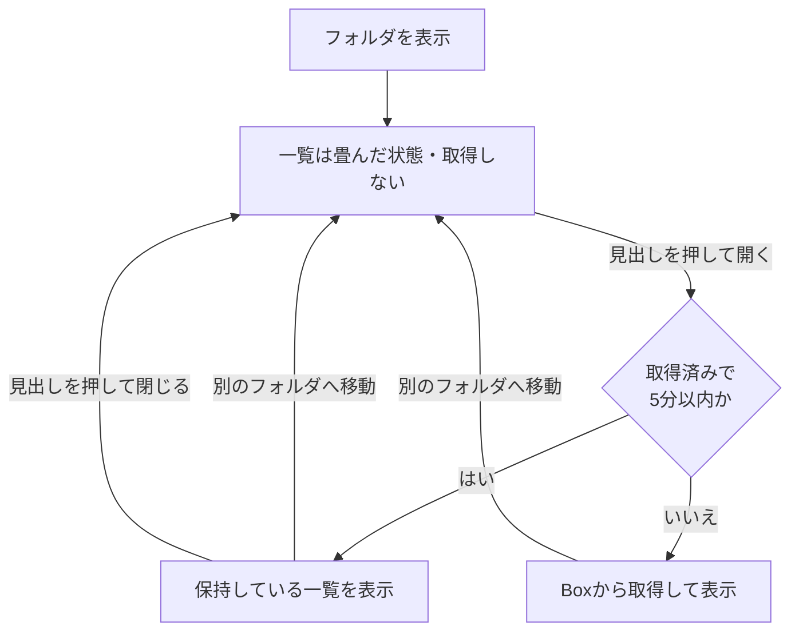

# SS 画面 技術仕様書

| 項目 | 内容 |
| --- | --- |
| 対象画面 | SS（センター専用領域のフォルダ閲覧・コラボレーション設定） |
| 実装 | `src/pages/SS.tsx` ほか（第 4 章） |
| 作成日 | 2026-11-05 |
| 作成方法 | ソースコードの解析による（実装が正であり、本書は実装から起こした仕様である） |
| 関連資料 | [useBoxExplorer フック 仕様書](./spec-use-box-explorer.md)（フォルダ移動・履歴・復元の詳細）<br>[画面仕様書案（非エンジニア向け）](./screen-spec-user-sharearea-ss.md)（画面上の文言・操作）<br>[Box API 呼び出し回数の削減対応 報告書](./report-box-api-call-reduction.md) |

## 1. 目的と範囲

### 1.1 目的

SS 画面は、ShareArea 画面で選択された「センター専用領域」について、次の 2 つを提供する。

1. Box のフォルダを閲覧し、対象フォルダを選ぶ（Box UI Elements の Content Explorer を埋め込む）。
2. 選んだフォルダに対する **コラボレーション**（ユーザーまたは部署への Box のアクセス権）を一覧・追加・ロール変更・削除する。

### 1.2 範囲

- 本書は、SS 画面の構造・状態・外部とのやりとり・動作を対象とする。
- 画面上の文言や操作手順は、[画面仕様書案](./screen-spec-user-sharearea-ss.md)を参照する。ただし同書には、現行実装と差異のある箇所がある（第 13 章）。
- ファイルの閲覧・アップロード等の機能は、Box 側の画面部品が提供するもので、本書の対象外である。

### 1.3 前提

- 本リポジトリの API 層（`src/api/index.ts`）は **インメモリのモック実装** であり、実際の通信は行わない（`CLAUDE.md` の記載どおり）。本番の API は別途用意されており、本書では、モックの型定義を **インターフェース契約** として扱う。本番 API のエンドポイントやエラー形式は、本リポジトリからは確認できない（第 12 章）。
- Box の画面部品は、`index.html` が CDN から読み込む（`elements/23.0.0`）。

## 2. 画面の位置づけ

### 2.1 ルーティング

| パス | 動作 | 定義 |
| --- | --- | --- |
| `/job/ShareArea` | ShareArea 画面（領域のカード一覧） | `UrlPath.ShareArea` |
| `/job/ShareArea/:rootFolderId` | **SS 画面** | `UrlPath.SS` |
| `/job/ShareArea/:rootFolderId/manage` | SS 画面へリダイレクト（旧 URL の互換） | `UrlPath.SSManageLegacy` |

- SS 画面は、共通レイアウトの外側のルートとして定義されている（独自に `Layout` を持つ。`fluid` 指定、`subtitle` に領域名）。
- `:rootFolderId` は、領域のルートとなる Box のフォルダ ID である。

### 2.2 画面遷移

```
ShareArea ── 「コラボレーション設定」ボタン ──▶ SS（rootFolderId = 領域の boxFolderId）
SS ── 「ShareArea に戻る」ボタン ──▶ ShareArea（このとき復元用の保存状態を破棄する）
SS ── サイドメニュー等で他の画面へ ──▶ 他画面（保存状態は残る → 戻ると復元される）
```

### 2.3 アクセス制御

- `:rootFolderId` が、`SHARE_AREAS`（`src/config/shareAreaConfig.ts`）のいずれかの `boxFolderId` と一致しない場合は、ShareArea 画面へリダイレクトする（`isShareAreaRouteFolderId`）。
- 本アプリは、ログイン利用者がその領域に入れるかの判定を **行わない**。実際のアクセス可否は、Box の権限による。
- `SHARE_AREAS` は、現状は設定ファイルの固定値である。本番では、ログイン利用者の所属に応じて API が返す一覧を用いる想定であり、その場合は、このチェックも API の結果と照合する形への変更が必要となる（第 12 章）。

## 3. 画面構成

```
SS（ルート検証。無効な ID は ShareArea へ）
└─ SSContent（key = rootFolderId。領域が変わると作り直される）
   └─ Layout（fluid, subtitle = 領域のフォルダ名）
      ├─ BoxManager（Box のアクセストークンの取得・更新。表示はなし）
      ├─ 「ShareArea に戻る」ボタン
      ├─ PathBar（現在のパス、戻る/進む、パスのコピー、Web Box / Box Drive で開く）
      │   └─ 復元中は PathBarSkeleton
      └─ 2 カラム
         ├─ 左: Box Content Explorer を埋め込む領域（.box-container）
         │   ├─ アクセストークンがないとき: 「Box に接続中...」
         │   └─ 復元中: ExplorerRestoreSkeleton を重ねて表示
         └─ 右（幅 24rem）: CollaborationPanel
             ├─ 復元中: CollaborationPanelSkeleton
             ├─ フォルダ名
             ├─ コラボレーターを追加（部署・社員の検索、ロール、追加ボタン）
             └─ コラボレータ一覧（開閉式。見出し: タイトル + 開閉アイコン（右側。畳んでいるときは右向き、開いているときは下向き））
                 └─ CollaboratorRow（行ごと）
```

- 変更操作（追加・削除・ロール変更）の実行中は、右カラムにローディング表示を重ねる。
- 画面幅が狭いときは、2 カラムが縦に並ぶ。

## 4. 構成要素

| 要素 | ファイル | 責務 |
| --- | --- | --- |
| `SS` / `SSContent` | `src/pages/SS.tsx` | ルート検証、Box 画面部品のライフサイクル管理、コラボレーション操作の制御、各部品の組み立て |
| `useBoxExplorer` | `src/hooks/useBoxExplorer.ts` | 現在のフォルダ、履歴（戻る/進む）、復元の状態管理（[別紙](./spec-use-box-explorer.md)） |
| `PathBar` | `src/components/ss/PathBar.tsx` | パスの表示、戻る/進む、パスのコピー、外部で開くボタン（表示のみ。処理は親が持つ） |
| `CollaborationPanel` | `src/components/ss/CollaborationPanel.tsx` | 追加フォーム、一覧の開閉、一覧の描画（表示のみ） |
| `CollaboratorRow` | `src/components/ss/CollaboratorRow.tsx` | 一覧 1 行の表示、ロール変更・削除の確認ダイアログ |
| `ssHelpers` | `src/pages/ssHelpers.ts` | パスの組み立て、継承元パスの対応表、API 応答の表示用への変換（純粋関数） |
| `ssSlice` | `src/redux/slices/ssSlice.ts` | コラボレーター一覧、現在フォルダ・履歴の保持と、API 呼び出しの thunk |
| `BoxManager` | `src/components/common/BoxManager/BoxManager.tsx` | Box のアカウント ID・アクセストークンの取得と更新 |
| `ssConstants` | `src/constants/ssConstants.ts` | 表示用パスの起点、ロールの選択肢と既定値 |
| `types/ss.ts` | `src/types/ss.ts` | 画面で使う型 |

## 4A. 定数

| 名称 | 値 | 用途 |
| --- | --- | --- |
| `DISPLAY_PATH_ROOT` | `\share\` | 画面に表示するパスの起点 |
| `DEFAULT_ROLE` | `viewer` | 追加フォームのロールの初期値 |
| `ROLE_OPTIONS` | `editor`（表示名 Editor）/ `viewer`（Viewer） | ロールの選択肢 |
| `COLLABORATIONS_TTL_MS` | 300,000（5 分） | コラボレーター一覧のキャッシュの有効時間。**キャッシュは暫定的に既定で無効**（`configureCollaborationsCache`、環境変数 `VITE_BOX_COLLABORATIONS_CACHE=true` で有効） |
| 状態確認の間隔 | 5 分 | `BoxManager` のトークン期限の確認間隔 |
| トークンの更新基準 | 取得から 2,940 秒（49 分）超 | `BoxManager` |

## 5. 状態

### 5.1 Redux（`ss` スライス）

| 項目 | 型 | 内容 |
| --- | --- | --- |
| `byFolderId` | `Record<フォルダID, 一覧>` | Box が返したコラボレーションの生データを、フォルダごとに保持する。継承分も含まれる |
| `collaborationStatusByFolderId` | `Record<フォルダID, "idle"｜"loading"｜"succeeded"｜"failed">` | 一覧の取得状態 |
| `collaborationFetchedAtByFolderId` | `Record<フォルダID, ミリ秒>` | 一覧を取得した時刻。キャッシュの有効判定に使う。破棄すると未取得扱いになる |
| `currentFolderByRootId` | `Record<ルートID, FolderInfo>` | 領域（ルート）ごとの、離脱時の現在フォルダ。復元に使う |
| `folderHistoryByRootId` | `Record<ルートID, フォルダID[]>` | 領域ごとの履歴 |
| `historyIndexByRootId` | `Record<ルートID, 数値>` | 領域ごとの履歴上の現在位置 |
| `isLoading` / `error` | | 一覧取得の共通状態 |

- 領域（ルート）ごとに現在フォルダと履歴を持つため、複数の領域を行き来しても、互いに干渉しない。
- Redux ストアは **永続化されていない**（`redux-persist` なし）。ページの再読み込みで、復元用の状態は失われる。

#### アクション（reducers）

| 名称 | 内容 |
| --- | --- |
| `setCurrentFolder` | 領域ごとの現在フォルダを保存 |
| `setFolderHistory` | 領域ごとの履歴と位置を保存 |
| `clearCurrentFolder` / `clearFolderHistory` | 領域の現在フォルダ / 履歴を破棄 |
| `invalidateCollaborations` | **全フォルダ分** の一覧のキャッシュ（取得時刻）を破棄する |

#### 非同期処理（thunk）

| 名称 | 内容 |
| --- | --- |
| `getFolderCollaborations(フォルダID)` | Box から一覧を取得し、`byFolderId` と取得時刻を更新する。必ず通信する |
| `ensureFolderCollaborations(フォルダID)` | 取得済みで 5 分以内なら、保持している一覧を返す。それ以外は `getFolderCollaborations` で取得して返す |
| `createCollaborations` / `updateCollaborations` / `deleteCollaborations` | 追加・更新・削除。失敗時は、エラーの文字列で reject する |

### 5.2 他スライスから参照するもの

| 項目 | 内容 |
| --- | --- |
| `user`: ログイン状態、ログインユーザー ID、Box のアクセストークン | Box 画面部品の表示条件、Box Drive のパス生成 |
| `autoComplete`: グループの一覧（`groups`） | 追加対象が「部署」か「社員」かの判定 |

### 5.3 `SSContent` のローカル状態

| 状態 | 内容 |
| --- | --- |
| `explorerInstance` | Box の Content Explorer のインスタンス（初回の描画後に 1 度だけ生成） |
| `openListFolderId` | コラボレーター一覧を開いているフォルダの ID（開いていなければ `null`）。**ID で持つため、フォルダを移動すると自動で畳んだ状態に戻る** |
| `selectedCollaborator` / `selectedRole` | 追加フォームの選択値。フォルダが変わるとリセットされる |
| `isAddingCollaborator` / `isRemovingCollaborator` / `isUpdatingCollaborator` | 各変更操作の実行中フラグ。いずれかが true の間は操作を受け付けない（`isMutating`） |
| `initialRestoreTargetIdRef` | 復元先のフォルダ ID。マウント時点の値で固定する |
| `hasShownRef` | Box 画面部品を `show()` 済みか |

## 6. 外部とのやりとり

### 6.1 API（`BoxApi`。モックの型より）

| 操作 | メソッド | 引数 | 戻り値 |
| --- | --- | --- | --- |
| 一覧の取得 | `getFolderCollaborations` | フォルダ ID | コラボレーションの配列 |
| 追加 | `createCollaborations` | `CreateCollaborationsParams` | — |
| ロール変更 | `updateCollaboration` | コラボレーション ID、`{ role }` | — |
| 削除 | `deleteCollaborations` | コラボレーション ID | — |
| アカウント ID | `getBoxAccountId` | ユーザー ID | Box のアカウント ID |
| アクセストークン | `getContentsPickerToken` | アカウント ID | `{ accessToken }` |

#### コラボレーション 1 件（`GetFolderCollaborationsResponse`）

| 項目 | 内容 |
| --- | --- |
| `id` | **コラボレーションのレコード ID**（ユーザー ID・グループ ID ではない）。更新・削除の指定に使う |
| `role` | `editor` / `viewer` |
| `can_view_path`（または `canViewPath`） | 経路の閲覧を許可しているか。表記が 2 通りあるため、両方を受け付ける |
| `accessible_by` | `{ id, type: "user"｜"group", name }`。対象者 |
| `item` | `{ id, type: "folder", name }`。**そのコラボレーションが設定されているフォルダ**。現在のフォルダと異なれば「継承」 |

#### 追加のパラメータ（`CreateCollaborationsParams`）

| 項目 | 値 |
| --- | --- |
| `folderId` | 現在のフォルダ ID |
| `collaboratorId` | 選択した対象の ID |
| `collaboratorType` | 対象が `groups` に含まれれば `department`、そうでなければ `user` |
| `collaboratorName` | 選択した対象の表示名 |
| `role` | 選択したロール |
| `can_view_path` | **常に `true`** |

> 本アプリが作成するコラボレーションは、常に `can_view_path = true` である。この値が true のものだけを「管理対象」（変更・削除できる）として扱う。

### 6.2 Box UI Elements（Content Explorer）

#### 生成と表示

- `window.Box.ContentExplorer` のインスタンスを、画面の表示後に 1 度だけ生成する。
- 次の 3 つが揃ったときに `show()` を呼ぶ: インスタンス、ログイン済み、アクセストークン。`show()` の依存値（ルート ID、トークン、ログイン状態）が変わると、再度呼ばれる。
- `show(ルートID, アクセストークン, オプション)` のオプション:

| オプション | 値 | 目的 |
| --- | --- | --- |
| `container` | `.box-container` | 描画先 |
| `currentFolderId` | 離脱時のフォルダ ID（ルートと異なるときのみ） | 復元時に、ルートを経由せず直接表示する |
| `canPreview` | `false` | プレビューを無効にする |
| `canUpload` / `canDelete` / `canRename` / `canCreateNewFolder` | `false` | 変更系操作のボタンを表示しない（画面上のみ。Box 側の権限は変わらない） |
| `requestInterceptor` / `responseInterceptor` | `boxFolderCache` の中継処理（キャッシュが有効なときのみ。**暫定的に既定で無効**。`VITE_BOX_FOLDER_CACHE=true` で有効） | フォルダ取得を 5 分間キャッシュする（6.2A） |
| `size` | `large` | 表示サイズ |

- 第 1 引数のルート ID は、パンくずの起点として使われる。
- アクセストークンは、Redux のトークン、なければ `localStorage` の `box_dev_token`（開発用）の順で使う。

#### 6.2A フォルダ取得のキャッシュ（`src/lib/boxFolderCache.ts`）

- Explorer は、フォルダを開くたびに（訪問済みでも）`GET /folders/{id}` を呼ぶ。この応答を、5 分間保存し、同じ要求には通信せずに保存済みの応答を返す。
- 対象は、フォルダ取得のみ。保存のキーは、アクセストークン、パス、パラメータ（並び替え・ページ位置など）。
- 保存は画面の外（モジュール単位）で行うため、画面を離れても、領域を行き来しても残る。
- パスバーの更新ボタンで、キャッシュを全て破棄し、現在のフォルダを取り直せる（コラボレーター一覧の更新を含む。7.4A）。
- 環境変数 `VITE_BOX_FOLDER_CACHE=false` で無効にできる。開発時は、命中・未命中をコンソールに出力する。
- 詳細は、[Box フォルダ取得キャッシュ 設計・仕様書](./spec-box-folder-cache.md)と、[報告書](./report-box-api-call-reduction.md)の 4.5 節を参照する。

#### イベント

- `navigate` イベントで、フォルダ移動を `useBoxExplorer` に通知する。リスナーは、登録の前後に `removeAllListeners` で整理する。

#### 破棄

- 画面を離れるとき、`show()` 済みであれば `hide()` を呼ぶ。`hide()` が例外を投げても、遷移は妨げない。

### 6.3 外部アプリの起動

| 操作 | 動作 |
| --- | --- |
| Web Box で開く | `https://app.box.com/folder/{現在のフォルダID}` を新しいタブで開く（`noopener,noreferrer`） |
| Box Drive で開く | `isexplorer:{エンコードしたローカルパス}` を `window.open` で開く。ローカルパスは `C:\Users\{ユーザーID}\Box\{経路}\{現在のフォルダ名}`。経路は Box のパス情報からルート（ID `0`）を除いたもの |
| パスのコピー | 表示用のフルパス（`\share\…`）をクリップボードへ |

> Box Drive のパスは、`C:\Users\` と `\Box` を **固定の文字列** で組み立てている。Box のインストール先が異なる環境では、正しく開けない。

## 7. 動作仕様

### 7.1 初期化の流れ

1. ルート検証を行う（無効な ID は ShareArea へ）。
2. `BoxManager` が、ログイン済みであればアカウント ID を取得し、続けてアクセストークンを取得する。
3. 現在フォルダ・履歴・復元先を、Redux の領域別の保存値から決める。

   | 項目 | 決め方 |
   | --- | --- |
   | 初期の現在フォルダ | 保存値があればそれ。なければルート（名前は空） |
   | 初期の履歴 | 保存値。先頭がルートでなければ、ルートを先頭に補う。空ならルートのみ |
   | 履歴の位置 | 保存値（既定 0） |
   | 復元先 | 保存した現在フォルダがルートと異なるときのみ、その ID |

4. Explorer のインスタンスを生成し、トークンが揃えば `show()` する。復元先があれば `currentFolderId` を渡す。
5. 最初の `navigate` イベントで、現在フォルダが確定する。

### 7.2 復元

- 他の画面へ移動し、再び同じ領域の SS 画面へ戻ると、離脱時のフォルダを復元する。
- 復元中は `isRestoring` が true になり、パスバー、Explorer、右カラムをスケルトン表示にする。
- 復元の判定・手順の詳細は、[useBoxExplorer 仕様書](./spec-use-box-explorer.md)の復元の章を参照する。
- 「ShareArea に戻る」で離れた場合は、現在フォルダと履歴を破棄するため、**復元されない**（次回はルートから表示する）。
- 復元の状態は Redux のメモリ上にあり、ページの再読み込みで失われる。

### 7.3 フォルダの移動

- 利用者が Explorer でフォルダを開く、パンくずで移動する、戻る/進むを押す、のいずれも、Explorer の `navigate` イベントが `useBoxExplorer` に通知され、現在フォルダと履歴が更新される想定である。
- 「戻る / 進む」でも、Explorer が `navigateTo` の結果として発火する `navigate` イベントで、現在フォルダが更新される（この処理は、2026-11-05 に修正した。修正前は、イベントが無視され、パスバーと右カラムが移動前のフォルダのままになっていた）。詳細は [useBoxExplorer 仕様書](./spec-use-box-explorer.md)の第 8 章を参照する。
- 現在フォルダが変わると、次が起きる。
  - 右カラムのフォルダ名が更新される。
  - 追加フォームの入力がリセットされる。
  - コラボレーター一覧が、畳んだ状態に戻る（7.4）。
  - パスバーが更新される（7.8）。

### 7.4 コラボレーター一覧

#### 状態遷移



| 項目 | 仕様 |
| --- | --- |
| 初期状態 | 畳んだ状態。通信しない |
| 開く | 開いたフォルダ分の一覧を、`ensureFolderCollaborations` で取得する。キャッシュは既定で無効なので、毎回通信する（有効にしたときは、5 分以内なら通信しない） |
| 閉じる | 描画しない。キャッシュは残る |
| 更新 | 一覧専用のボタンはない。パスバーの更新ボタン（7.8、7.4A）が、一覧もまとめて更新する |
| フォルダ移動 | 畳んだ状態に戻る |
| 復元中 | 取得しない |
| 取得中 | 一覧が未取得のときは、行のスケルトンを 5 行表示する |
| 取得失敗 | エラーメッセージを表示する（第 9 章） |
| 0 件 | 「コラボレーターは設定されていません」 |
| キャッシュの破棄 | 追加・削除・ロール変更の後と、パスバーの更新ボタンを押したときに、全フォルダ分を破棄する（7.4A、7.5〜7.7） |

#### 7.4A 更新ボタン（パスバー）による、一覧の更新

パスバーの更新ボタン（7.8）は、フォルダの表示と、コラボレーター一覧を、**まとめて** 最新にする。一覧専用の更新ボタンは、置かない。

| 項目 | 内容 |
| --- | --- |
| 一覧のキャッシュ | **全フォルダ分を破棄** する |
| 一覧が開いているとき | 現在のフォルダの一覧を、Box から取り直す（追加・削除・ロール変更の後の再取得と同じ処理） |
| 一覧が畳まれているとき | 取得しない。次に開いたときに、取得する |
| 失敗 | 「コラボレーター一覧の取得に失敗しました」を表示する（フォルダの更新は、行われる） |

- **全フォルダ分を破棄する理由**: 一覧には、親フォルダから継承された設定も含まれる。他の管理者が親フォルダを変更すると、配下のフォルダの一覧も古くなる。現在のフォルダだけを取り直すと、他のフォルダで、最大 5 分は古い一覧が出る。権限の管理画面のため、全て破棄する。
- 破棄による通信の増加は、「更新の後に、もう一度開いたフォルダ」の分だけで、数回程度である。
- **ボタンを 1 つにまとめた理由**: 利用者の目的は、ほとんどが「今見ている画面を最新にしたい」である。フォルダか一覧かを、利用者に選ばせないほうが、説明が簡単で、「更新したのに古い」という誤解が起きにくい。増える通信は、一覧が開いているときの 1 回だけである。

#### 表示ルール

- 一覧の元データは、現在のフォルダに対する Box の応答であり、親フォルダからの継承分を含む。
- 各行は、次のルールで表示用に変換される（`toCollaborationListItem`）。

| 項目 | ルール |
| --- | --- |
| 継承か直接か | `item.id`（コラボレーションが設定されているフォルダ）が、現在のフォルダと異なれば「継承」。`item` がなければ直接とみなす |
| 種別 | `accessible_by.type` が `group` なら「部署」、それ以外は「ユーザー」 |
| 名前 | `accessible_by.name`。なければ「名称未設定」 |
| 管理対象か | `can_view_path`（または `canViewPath`）が true、未指定なら true。管理対象のみ、ロール変更・削除ができる |
| 継承元パス | 継承のときのみ、継承元フォルダのパスを表示する。パスは現在フォルダの階層から作る対応表で引く |

- 並び順は、次の優先順位で決まる。
  1. 管理対象（編集可）が先
  2. 直接が先、継承が後
  3. 種別の文字列順（部署 → ユーザー）
- 継承の行は背景色を変え、継承アイコンを付ける。管理対象でない行は、薄く表示し、ロールをバッジで示す（変更・削除は不可）。

### 7.5 コラボレーターの追加

1. 部署・社員を検索して選ぶ（未選択の間は追加ボタンが押せない）。ロールを選ぶ（既定は Viewer）。
2. 追加ボタンを押すと、確認ダイアログを表示する。OK で処理を続行する。
3. 処理中フラグを立てる。
4. **現在のフォルダの一覧を、キャッシュを使わず Box から取得する。** 失敗したら、エラーを表示して中止する。
5. 重複チェックを行う。管理対象のコラボレーションの中に、同じ対象（ID と種別が一致）があれば、エラーを表示して中止する。
6. 追加を実行する（`can_view_path = true`）。失敗したら、エラーを表示して中止する。
7. キャッシュを全て破棄する。一覧が開いていれば、最新を取得し直す。畳んでいれば、取得しない（次に開いたときに取得する）。
8. 完了メッセージを表示し、フォームをリセットする。7 の取得に失敗したときは、「追加は完了しましたが一覧の更新に失敗しました」を表示する。

> 手順 4 でキャッシュを使わないのは、他の人が直前に追加していた場合に、古いキャッシュで重複チェックをすり抜けないようにするためである。

### 7.6 ロール変更

1. 管理対象の行で、ロールを変更する。元と同じ値を選んだときは、何も起きない。
2. 確認ダイアログを表示する。キャンセル（または閉じる）すると、選択を元のロールへ戻す。継承の行は、**継承元のコラボレーションを変更する** 旨を、継承元のパスとともに表示する。
3. OK で、コラボレーション ID を指定して更新する。失敗したら、エラーを表示して中止する。
4. キャッシュを全て破棄する。一覧が開いていれば、再取得する。
5. 完了メッセージを表示する。再取得に失敗したときは、「更新は完了しましたが一覧の更新に失敗しました」を表示する。

### 7.7 コラボレーターの削除

1. 管理対象の行の削除ボタン（行にマウスを置くと表示される）を押す。
2. 確認ダイアログを表示する。継承の行は、継承元のコラボレーションを削除する旨を、継承元のパスとともに表示する。
3. OK で、コラボレーション ID を指定して削除する。失敗したら、エラーを表示して中止する。
4. 以降は 7.6 の 4〜5 と同じ（再取得失敗時は「削除は完了しましたが一覧の更新に失敗しました」）。

### 7.8 パスバー

| 要素 | 仕様 |
| --- | --- |
| パス表示 | `\share\` + 現在フォルダの経路。経路は、Box のパス情報からルート（ID `0`）を除き、フォルダ名を `\` で連結する。現在フォルダが ID `0`、または ID なしのときは、`\share\` のみ |
| 表示の分割 | 経路が 2 階層以上のときは、先頭の階層、中間、末尾の階層に分けて表示する。幅が足りないときは、中間の部分だけを省略（`…`）表示する。マウスを置くとフルパスを表示する |
| 戻る / 進む | 履歴上の前後のフォルダへ移動する。移動できないときは、ボタンを無効にする |
| 更新 | 「戻る / 進む」の右隣の、更新マークのボタン。フォルダ取得のキャッシュと、コラボレーター一覧のキャッシュを全て破棄し、現在のフォルダを Box から取り直す。**パスと Explorer の表示、コラボレーター一覧が、まとめて最新になる**（一覧が開いているときは、一覧も取り直す。7.4A） |
| パスをコピー | フルパスをクリップボードへコピーする。成功・失敗をメッセージで知らせる |
| Web Box で開く | 6.3 |
| Box Drive で開く | 6.3 |

### 7.9 「ShareArea に戻る」

- 領域の現在フォルダと履歴を Redux から破棄し、ShareArea 画面へ移動する。

### 7.10 Box のアクセストークンの管理

- `BoxManager` は、ログイン後にアカウント ID を取得し、続けてアクセストークンを取得する。
- 5 分ごとに、取得時刻を確認し、**取得から 49 分を超えていれば再取得する**。
- 取得時刻は、Redux の `tokenDt` に保存される。

## 8. 表示状態の一覧

| 状態 | パスバー | Explorer 領域 | 右カラム |
| --- | --- | --- | --- |
| アクセストークンなし | 通常 | 「Box に接続中...」 | 通常 |
| 復元中 | スケルトン | スケルトンを重ねる | スケルトン |
| 変更操作の実行中 | 通常 | 通常 | ローディングを重ねる。追加・ロール・削除の操作を受け付けない |
| 一覧が畳まれている | 通常 | 通常 | 見出しのみ（一覧は非表示） |
| 一覧の取得中 | 通常 | 通常 | 行のスケルトン 5 行 |

## 9. メッセージ

| 契機 | 種別 | メッセージ |
| --- | --- | --- |
| パスをコピー（成功） | 成功 | パスをコピーしました |
| パスをコピー（失敗） | エラー | コピーに失敗しました |
| 一覧の取得に失敗（開いたとき、追加時の重複チェック時） | エラー | コラボレーター一覧の取得に失敗しました |
| 追加（重複） | エラー | 同じコラボレーターは既に設定されています |
| 追加（成功） | 成功 | {対象者名} を追加しました |
| 追加（失敗） | エラー | API が返したエラーの文字列。文字列でなければ「コラボレーターの追加に失敗しました」 |
| 追加（成功後に一覧の再取得に失敗） | エラー | 追加は完了しましたが一覧の更新に失敗しました |
| ロール変更（成功） | 成功 | {対象者名} のロールを更新しました |
| ロール変更（失敗） | エラー | API が返したエラーの文字列。文字列でなければ「コラボレーターのロール更新に失敗しました」 |
| ロール変更（成功後に再取得に失敗） | エラー | 更新は完了しましたが一覧の更新に失敗しました |
| 削除（成功） | 成功 | {対象者名} を削除しました |
| 削除（失敗） | エラー | コラボレーターの削除に失敗しました |
| 削除（成功後に再取得に失敗） | エラー | 削除は完了しましたが一覧の更新に失敗しました |

- 通知は、画面上部の通知（`toast`）で表示する。

## 10. 非機能

### 10.1 Box API の呼び出し

月間の API 呼び出し上限（100,000 回）に対し、呼び出し回数を抑える設計としている。詳細は[報告書](./report-box-api-call-reduction.md)を参照。要点:

- コラボレーター一覧は、開いたときだけ取得する。5 分間キャッシュする。変更後は全体を破棄する。
- 追加時の重複チェックでは、必ず最新を取得する。
- 復元時は、ルートを経由せず直接表示する。
- Explorer のフォルダ取得は、Box 側が毎回強制的に通信するため、設定では削減できない。通信の中継処理で、5 分間キャッシュする（6.2A。試作）。

### 10.2 レスポンシブ

- 画面幅が広いとき（`lg` 以上）は、左に Explorer、右に幅 24rem のコラボレーションパネルを並べる。それ未満では、縦に並べる。

## 11. テスト

| 対象 | ファイル | 備考 |
| --- | --- | --- |
| SS 画面 | `src/pages/SS.test.tsx` | `useBoxExplorer`、`PathBar`、`CollaborationPanel` はスタブに置き換えて検証している |
| ヘルパー | `SS.test.tsx` 内 | `toCollaborationListItem` 等の分岐 |
| スライス | `src/redux/slices/ssSlice.test.ts` | キャッシュの有効時間、無効化など |
| フォルダ取得のキャッシュ | `src/lib/boxFolderCache.test.ts`（35 件） | 保存・命中・有効時間・分離・実際の axios での通信の省略 |
| パネル / 行 / パスバー | `src/components/ss/*.test.tsx` | |
| `useBoxExplorer` | `src/hooks/useBoxExplorer.test.tsx`（30 件） | 履歴・復元・「戻る / 進む」を、フック単体で検証している |

## 12. 制約・既知事項・要確認

| 項目 | 内容 |
| --- | --- |
| 本番 API | このリポジトリのモックからは、エンドポイント、エラー形式（特に、重複追加時のエラー）が確認できない。要確認 |
| 領域の一覧 | ルート検証が、固定の `SHARE_AREAS` と照合している。本番で、ログイン利用者ごとに領域が変わる場合は、照合先の変更が必要 |
| 状態の永続化 | 復元用の状態は、ページの再読み込みで失われる |
| 一覧の古さ | 他の人の変更は、最大 5 分は反映されない（この画面からの変更は即時に反映される） |
| 一覧の開閉 | フォルダを移動すると畳んだ状態に戻る。開いた状態は引き継がない |
| 復元先の取得失敗 | 復元先が削除された、または権限を失った場合の処理がなく、復元中の表示が続く可能性がある |
| 復元先がルートの子孫でない場合 | Box 上で移動された場合など。パンくずが、All Files からの全階層で表示される |
| Box Drive のパス | `C:\Users\{ID}\Box` の固定。環境が異なると開けない |
| Explorer の領域 | 領域の描画は、アクセストークン（Redux）の有無で決まる。`localStorage` の開発用トークンのみがある場合、`show()` の呼び出しは行われるが、描画先の領域がなく、表示されない可能性がある（コード上の観察。未検証） |
| フォルダ取得のキャッシュ | 試作。Box の画面部品での実機の動作は未確認。他の人の変更は、Explorer に最大 5 分反映されない |
| 変更系操作の無効化 | 画面上のボタンを隠すだけで、Box 側の権限は変わらない |
| 画面部品のバージョン | Box UI Elements は `23.0.0` に固定。`currentFolderId` は公式未記載の挙動に依存している。更新時に確認が必要 |
| パスバーの表示 | 経路が 2 階層以上のとき、先頭の階層の表示が `\share\` + `\` + 階層名となり、バックスラッシュが 2 つ続く表記になる（コード上の観察。画面での確認は未実施） |
| 未使用ファイル | `src/hooks/useBoxExplorer2.tsx` は、どこからも参照されていない |

## 13. 既存の画面仕様書案との差異

[`screen-spec-user-sharearea-ss.md`](./screen-spec-user-sharearea-ss.md) の第 7 章（SS）と、現行実装の差異。提出前に、いずれかへの統一が必要。

| 箇所 | 画面仕様書案の記載 | 現行実装 |
| --- | --- | --- |
| 戻るボタンの名称（7.2） | 「センター専用領域に戻る」 | 「ShareArea に戻る」 |
| Box Drive で開く（7.3） | 「エクスプローラーで開きます」のメッセージを表示する | メッセージは表示しない（`isexplorer:` を開くのみ） |

> コラボレーター一覧の開閉・キャッシュ、追加時の重複チェックの最新取得は、画面仕様書案の 7.4〜7.6 に、2026-11-05 に反映済みである。
