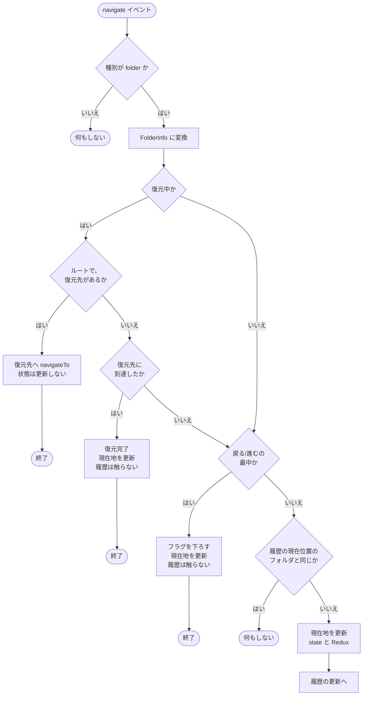

# useBoxExplorer フック 仕様書

| 項目 | 内容 |
| --- | --- |
| 対象 | カスタムフック `useBoxExplorer` |
| 実装 | `src/hooks/useBoxExplorer.ts`（227 行） |
| 作成日 | 2026-11-05 |
| 作成方法 | ソースコードの解析と、実際にフックを動かした挙動の確認による。実装が正であり、本書は実装から起こした仕様である |
| 関連資料 | [SS 画面 技術仕様書](./spec-ss-screen.md) / 開発者向けの解説 `src/hooks/useBoxExplorer.md`（設計意図・落とし穴） |

> **修正履歴**: 本書の作成中に、「戻る / 進む」の後に現在地が更新されない不具合を、実際にフックを動かして再現・確認した（第 8 章）。同日に修正し、フックの自動テスト（22 件）を追加した。本書は、**修正後の実装** を記述している。

## 1. 目的と責務

### 1.1 目的

Box の Content Explorer（ファイルブラウザ）上での **フォルダ移動の状態** を管理する。具体的には、次の 4 つ。

1. 現在表示しているフォルダ（現在地）
2. 移動の履歴と、その上での現在位置（戻る / 進む）
3. 他の画面から戻ったときの、離脱時のフォルダへの復元
4. 上記の状態の Redux への保存（領域ごと）

### 1.2 責務の範囲

| このフックが行う | このフックが行わない（呼び出し側 `SS.tsx` の責務） |
| --- | --- |
| 現在地・履歴の保持と更新 | Content Explorer のインスタンスの生成 |
| 「戻る / 進む」の実行（Explorer への移動指示） | `show()` による表示、表示オプションの指定 |
| 復元の進行状況の管理 | アクセストークンの管理 |
| Redux への現在フォルダ・履歴の書き込み | `navigate` イベントの登録（フックの `handleNavigate` を渡す） |
| | 破棄（`hide()`） |

## 2. インターフェース

### 2.1 引数（`UseBoxExplorerOptions`）

| 名称 | 型 | 内容 |
| --- | --- | --- |
| `rootFolderId` | `string` | この画面のルートとなる Box のフォルダ ID。Redux への保存のキー、復元の判定に使う |
| `initialFolder` | `FolderInfo` | 初期の現在地 |
| `savedHistory` | `string[]` | 初期の履歴（フォルダ ID の配列） |
| `savedIndex` | `number` | 初期の履歴上の位置 |
| `restoreTargetId` | `string`（省略可） | 復元先のフォルダ ID。指定があれば、復元中の状態で始まる |

> **すべての引数は、フックが最初に描画された時点の値だけが使われる**（refs と state の初期値）。その後に引数が変わっても、内部の状態には反映されない。このため、呼び出し側は、領域（`rootFolderId`）ごとにコンポーネントを作り直す（SS 画面は `key={rootFolderId}`）。

### 2.2 戻り値（`UseBoxExplorerResult`）

| 名称 | 型 | 内容 |
| --- | --- | --- |
| `explorerRef` | `MutableRefObject<ContentExplorerInstance \| undefined>` | Explorer のインスタンスを差し込む ref。呼び出し側が、生成したインスタンスを代入する。フックは、これを通して `navigateTo` を呼ぶ |
| `currentFolder` | `FolderInfo` | 現在地 |
| `folderHistory` | `string[]` | 履歴 |
| `historyIndex` | `number` | 履歴上の現在位置 |
| `isRestoring` | `boolean` | 復元中か |
| `canGoBack` | `boolean` | `historyIndex > 0` |
| `canGoForward` | `boolean` | `historyIndex < folderHistory.length - 1` |
| `handleNavigate` | `(item: BoxFolder) => void` | Explorer の `navigate` イベントのハンドラ |
| `handleGoBack` | `() => void` | 戻る |
| `handleGoForward` | `() => void` | 進む |

### 2.3 型

```ts
type FolderInfo = {
  id: string;
  name: string;
  pathCollection?: { entries: { id: string; name: string }[] };
};

// navigate イベントが渡す、Box のフォルダ情報（snake_case）
type BoxFolder = {
  id: string;
  type: string;
  name?: string;
  path_collection?: { entries: Array<{ id: string; name?: string }> };
};

type ContentExplorerInstance = {
  show: (folderId: string, token: string, opts: unknown) => void;
  hide?: () => void;
  removeAllListeners?: () => void;
  addListener?: (event: "navigate", callback: (item: BoxFolder) => void) => void;
  navigateTo?: (folderId: string) => void;
};
```

## 3. 外部との関係

| 相手 | 関係 |
| --- | --- |
| Box Content Explorer（`window.Box.ContentExplorer`） | フックは `explorerRef.current.navigateTo(id)` を呼ぶ。Explorer は、フォルダの取得が成功すると `navigate` イベントを発火する（Box UI Elements v23.0.0 のソース上、`navigateTo` はフォルダ取得 `fetchFolder(id)` を呼び、取得成功時にイベントを発火する）。**実機での確認は未実施** |
| Redux `ss` スライス | `ssActions.setCurrentFolder({ rootFolderId, folder })` と `ssActions.setFolderHistory({ rootFolderId, history, index })` を dispatch する |
| 呼び出し側 | `handleNavigate` を、Explorer の `navigate` イベントに登録する |

## 4. 内部状態

### 4.1 state と ref の二重管理

履歴と位置は、**state と ref の両方** で持つ。

| 役割 | 理由 |
| --- | --- |
| state | 画面の再描画（`canGoBack` の表示など） |
| ref | イベントハンドラの中で、直前の更新を含む最新値を同期的に読む（state は次の描画まで更新されない） |

| 名称 | 種別 | 初期値 | 内容 |
| --- | --- | --- | --- |
| `currentFolder` | state | `initialFolder` | 現在地 |
| `folderHistory` | state | `savedHistory` | 履歴 |
| `historyIndex` | state | `savedIndex` | 位置 |
| `isRestoring` | state | `Boolean(restoreTargetId)` | 復元中か |
| `folderHistoryRef` | ref | `savedHistory` | 履歴の最新値 |
| `historyIndexRef` | ref | `savedIndex` | 位置の最新値 |
| `isNavigatingRef` | ref | `false` | 「戻る / 進む」による移動の最中か |
| `isRestoringRef` | ref | `Boolean(restoreTargetId)` | 復元中か（同期読み取り用） |
| `restoreTargetIdRef` | ref | `restoreTargetId` | 復元先 ID（以後変わらない） |
| `explorerRef` | ref | `undefined` | Explorer のインスタンス |

### 4.2 `syncHistory(nextIndex, nextHistory)`

履歴を更新する **唯一の関数**。次の 5 つを同時に更新する。

1. `historyIndexRef`
2. `folderHistoryRef`
3. `historyIndex`（state）
4. `folderHistory`（state）
5. Redux（`setFolderHistory`）

### 4.3 不変条件

| # | 条件 |
| --- | --- |
| I-1 | 履歴を更新するときは、必ず `syncHistory` を使う。これにより、ref・state・Redux が一致する |
| I-2 | 現在地を更新するときは、state と Redux（`setCurrentFolder`）の両方を更新する（復元先到達時を含む） |
| I-3 | 位置は、`0` 以上 `履歴の長さ - 1` 以下である |
| I-4 | 通常の移動（第 6.2 節）では、履歴に同じフォルダ ID が重複して追加されることはない |

> 「戻る / 進む」の押下から、移動先の `navigate` イベントを受けるまでの間は、履歴の位置は移動先を指すが、現在地は移動前のままである（履歴を先に更新するため）。イベントを受けると、現在地が一致する（第 6.1 節の段階 2）。

## 5. 履歴のモデル

ブラウザの履歴と同様の **スタック** を、位置（ポインタ）とともに持つ。

```
履歴: [R, A, B, C]
位置:          ^(3)
```

- `R` は、領域のルートである。履歴の先頭は常にルートでなければならない（呼び出し側が、初期値を作るときに保証する。`SS.tsx` の `initialHistory`）。
- フォルダを新しく開くと、位置より後ろを切り捨て、末尾に追加する。
- 履歴にすでにあるフォルダを開くと、追加せず、位置だけを動かす（第 6.2 節）。
- 履歴の長さに上限はない。

## 6. 動作仕様

### 6.1 `handleNavigate(item)`

Explorer の `navigate` イベントを受けて、状態を更新する中心の処理。

#### 処理の順序



| 段階 | 条件 | 動作 |
| --- | --- | --- |
| 0 | `item` が空、または種別が `folder` でない | 何もしない |
| 変換 | — | `FolderInfo` に変換する。`name` は、なければ空文字。`pathCollection` は、`path_collection` があれば、各要素の `name` が空のものを空文字にして変換し、なければ `undefined` |
| 1a | 復元中、かつ復元先があり、受けたフォルダがルート | 復元先へ `navigateTo` を呼ぶ。**状態は更新しない**。終了 |
| 1b | 復元中、かつ復元先があり、受けたフォルダが復元先 | 復元を完了する（`isRestoring` を false に）。現在地を更新する（state と Redux）。**履歴は触らない**（保存済みのものを使う）。終了 |
| 1c | 復元中だが、1a・1b のどちらでもない | 次の段階へ進む（第 8.4 節の挙動） |
| 2 | 「戻る / 進む」の最中（`isNavigatingRef` が true） | フラグを false にする。**現在地を更新する**（state と Redux）。履歴は触らない（「戻る / 進む」の処理が更新済み）。終了 |
| 3 | 履歴の現在位置のフォルダ ID が、受けたフォルダ ID と同じ | **何もしない**（Explorer が重複して発火する場合の保険） |
| 4 | — | 現在地を更新する（state と Redux） |
| 5 | — | 履歴を更新する（第 6.2 節） |

### 6.2 履歴の更新（ユーザーがフォルダを開いた場合）

位置を `i`、履歴を `H`、受けたフォルダを `f` とする。

| 順 | 条件 | 動作 |
| --- | --- | --- |
| 1 | `H` の `0` から `i` までに `f` がある（後ろから探す） | 位置をその場所へ動かす。履歴は変えない（パンくずで手前に戻った場合） |
| 2 | `H` の `i + 1` 以降に `f` がある | 位置をその場所へ動かす。履歴は変えない |
| 3 | どちらにもない | `H` を `i` までで切り捨て、末尾に `f` を追加し、位置をその末尾にする |

#### 確認した動作の例

初期の履歴を `[R]`（位置 0）とする。`R` はルート。

| 操作（受けたイベント） | 履歴 | 位置 | 現在地 | 規則 |
| --- | --- | --- | --- | --- |
| A を開く | `[R, A]` | 1 | A | 3 |
| B を開く | `[R, A, B]` | 2 | B | 3 |
| C を開く | `[R, A, B, C]` | 3 | C | 3 |
| パンくずで B へ | `[R, A, B, C]` | 2 | B | 1 |
| B がもう一度通知される | 変化なし | 2 | B | 段階 3（重複） |
| ファイル（種別が file）が通知される | 変化なし | 2 | B | 段階 0 |
| パンくずで A へ | `[R, A, B, C]` | 1 | A | 1 |
| B を開く（履歴では先） | `[R, A, B, C]` | 2 | B | 2 |
| Z を開く（途中から新規） | `[R, A, B, Z]` | 3 | Z | 3（C は切り捨てられる） |

### 6.3 `handleGoBack()` / `handleGoForward()`

| 項目 | 戻る | 進む |
| --- | --- | --- |
| 実行条件 | `canGoBack`（位置が 0 より大きい） | `canGoForward`（位置が最後より前） |
| 移動先の位置 | 現在位置 − 1 | 現在位置 + 1 |
| 移動先が空 | 何もしない | 何もしない |

実行できるとき、次の順で処理する。

1. `isNavigatingRef` を true にする。
2. `syncHistory` で、位置を更新する（履歴は変えない）。
3. `explorerRef.current.navigateTo(移動先のフォルダ ID)` を呼ぶ（インスタンスがなければ呼ばない）。

- 位置は、ref から読む（連続して押されたときに、state が古い値のままになるのを避けるため）。
- 実行できないとき（先頭で「戻る」、末尾で「進む」）は、`navigateTo` も呼ばれない。

### 6.4 復元

他の画面から戻ったときに、離脱時のフォルダを表示する。

| 項目 | 内容 |
| --- | --- |
| 開始 | `restoreTargetId` が渡されると、最初から `isRestoring = true` |
| 履歴 | 保存済みの `savedHistory` / `savedIndex` をそのまま使う。復元中は、履歴を書き換えない |
| 現在地の初期値 | `initialFolder`（保存済みの現在フォルダ）。復元先到達時に、`navigate` イベントの内容で更新する |
| 完了 | 復元先のフォルダの `navigate` イベントを受けたとき（段階 1b） |
| 表示への影響 | 復元中は、呼び出し側がスケルトンを表示する |

#### 復元の 2 つの経路

| 経路 | 流れ | 状態 |
| --- | --- | --- |
| 直接表示（現行の `SS.tsx`） | 呼び出し側が `show()` の `currentFolderId` に復元先を指定する → 最初の `navigate` が復元先 → 段階 1b で完了 | `navigateTo` は呼ばれない |
| ルート経由（旧方式。保険として残存） | `show()` はルートを表示する → ルートの `navigate` を受ける → 段階 1a で復元先へ `navigateTo` → 復元先の `navigate` を受ける → 段階 1b で完了 | `navigateTo` を 1 回呼ぶ |

### 6.5 Redux への書き込み

| 契機 | 書き込み |
| --- | --- |
| 現在地の更新（段階 1b、段階 2、段階 4） | `setCurrentFolder({ rootFolderId, folder })` |
| 履歴の更新（`syncHistory`） | `setFolderHistory({ rootFolderId, history, index })` |
| 復元の開始時・復元中 | 書き込まない（保存済みの値をそのまま使う） |

## 7. 他の部分との関係

- `SS.tsx` は、Redux の保存値から、フックの引数を作る。
  - 履歴の先頭がルートでなければ、補う。
  - 保存した現在フォルダがルートと異なるときだけ、`restoreTargetId` を渡す。
- 「ShareArea に戻る」ボタンは、Redux の現在フォルダと履歴を破棄する。そのため、次に入るときは、復元されない。
- フックの戻り値は、パスバー（現在地、戻る / 進むの可否）、コラボレーション一覧（現在地のフォルダ ID）、スケルトンの表示（`isRestoring`）に使われる。

## 8. 発見された不具合と修正（修正済み）と、残る注意点

本書の作成時に、実際にフックを動かし、Explorer の `navigate` イベントを模擬して確認した。

### 8.1 【修正済み】「戻る / 進む」の直後の `navigate` イベントが無視されていた

**修正前の挙動（確認済み）**

1. A、B の順にフォルダを開く。履歴 `[R, A, B]`、位置 2、現在地 B。
2. 「戻る」を押す。位置が 1 になり、`navigateTo(A)` が呼ばれる。
3. Explorer が、A の `navigate` イベントを発火する（`navigateTo` の結果として）。

| 項目 | 期待 | 修正前の実際 |
| --- | --- | --- |
| 現在地（state / Redux） | A | **B のまま** |
| `isNavigatingRef` | false に戻る | **true のまま** |

**原因**: 「戻る」の処理（6.3 の手順 2）が、先に位置を更新する。その後に届く A のイベントでは、「履歴の現在位置のフォルダ」が A になっているため、重複通知の判定に一致し、現在地の更新と、フラグを下ろす処理に到達しなかった。

**修正**: 「戻る / 進む」の最中の判定を、重複通知の判定より **前** に移し、その分岐の中で、現在地の更新（state と Redux）を行うようにした（`useBoxExplorer.ts` の `handleNavigate`）。

### 8.2 【修正済み】「戻る / 進む」の後の、最初のクリックが履歴に積まれなかった

8.1 の結果として、フラグが true のまま残り、次のクリックのイベントが「戻る / 進むの最中」と判定され、履歴の更新が行われなかった（修正前: 履歴 `[R, A, B]`、位置 1 のまま、現在地だけ C になる）。8.1 の修正により、フラグが正しく下りるため解消した。

### 8.3 【未対応】「戻る / 進む」の呼び出しで、Explorer のインスタンスがない場合

Explorer のインスタンス（`explorerRef.current`）がないときに「戻る」を押すと、位置だけが動き、`navigateTo` が呼ばれない。イベントが来ないため、フラグが true のまま残り、**次のクリックが履歴に積まれない**（修正前に確認。修正後も変わらない）。通常の利用では、インスタンスがないときにパスバーの操作は行えない想定である。対応する場合は、`navigateTo` が呼べるときだけフラグを立てる、などの方針となる。

### 8.4 【現行の仕様】復元中に、無関係なフォルダのイベントを受けた場合

復元中（`isRestoring` が true）に、ルートでも復元先でもないフォルダのイベントを受けると、通常の移動として扱われる（段階 1c）。履歴にそのフォルダが追加され、現在地が更新される。`isRestoring` は、復元先に到達するまで true のままである（確認済み）。

### 8.5 修正前の影響（参考）

| 影響 | 内容 |
| --- | --- |
| パス表示・コラボレーション一覧 | 「戻る / 進む」の直後、Explorer は移動後のフォルダを表示するが、パスバーと右カラム（フォルダ名、コラボレーター一覧）は、移動前のフォルダのままだった |
| 履歴の整合 | 「戻る / 進む」の後の最初のクリックが履歴に積まれず、履歴の位置と現在地が一致しなくなった |
| 復元 | 離脱時に保存される現在フォルダ・履歴が、実際の表示とずれた |

> 実機での確認は未実施である。Box UI Elements のソース上は、`navigateTo` の結果として `navigate` イベントが発火する。

## 9. その他の制約

| 項目 | 内容 |
| --- | --- |
| 引数の変更の反映 | 引数は、最初の描画時の値だけが使われる（第 2.1 節）。呼び出し側で `key` により作り直す前提 |
| 復元先に到達しない場合 | 復元先のフォルダが削除された、権限を失ったなどで、`navigate` イベントが来ないとき、`isRestoring` は true のまま（スケルトンが消えない）。タイムアウト等の処理はない |
| 復元先がルートの子孫でない場合 | パンくずが、All Files からの全階層で表示される（Box UI Elements の仕様による） |
| 履歴の長さ | 上限がない |
| 現在地の名前 | Box からの名前がないときは、空文字になる |
| 描画ごとの関数の作り直し | `handleNavigate` は、`rootFolderId` と `syncHistory` が変わると作り直される。呼び出し側は、リスナーを付け替える（SS 画面は、`removeAllListeners` の後に追加している） |

## 10. テストの状況

| 項目 | 内容 |
| --- | --- |
| フック単体のテスト | `src/hooks/useBoxExplorer.test.tsx`（22 件）。Redux ストアを実物で用意し、`navigate` イベントを `handleNavigate` の直接呼び出しで模擬する |
| `SS.test.tsx` でのフックの扱い | フックを **モックに置き換えて** いる。フック自体の検証は、上記の単体テストで行う |
| 実機での確認 | 未実施 |

### 10.1 テストケースと仕様の対応

| # | 観点 | 状態 |
| --- | --- | --- |
| T-1 | 初期状態（引数の値、`isRestoring` が復元先の有無に一致） | 実装済み |
| T-2 | 新規フォルダが履歴の末尾に追加される（規則 3） | 実装済み |
| T-3 | パンくずで手前へ移動すると、履歴は変わらず位置のみ動く（規則 1） | 実装済み |
| T-4 | 履歴の先のフォルダへ移動すると、位置のみ動く（規則 2） | 実装済み |
| T-5 | 途中から新規フォルダへ移動すると、位置より後ろが切り捨てられる | 実装済み |
| T-6 | 同じフォルダの重複通知は無視される | 実装済み |
| T-7 | 種別が `folder` でないイベントは無視される | 実装済み |
| T-8 | 先頭で「戻る」、末尾で「進む」で、`navigateTo` が呼ばれない | 実装済み |
| T-9 | 「戻る」「進む」の結果のイベントで、現在地が移動先に更新される | 実装済み（修正前は不合格だったことを確認） |
| T-10 | 「戻る」の後の最初のクリックが、履歴に積まれる | 実装済み（修正前は不合格だったことを確認） |
| T-11 | 「戻る」を続けて押すと、位置が 2 つ戻る | 実装済み |
| T-12 | 復元（直接表示）: 復元先のイベントで完了。履歴は変わらず、`navigateTo` は呼ばれない | 実装済み |
| T-13 | 復元（ルート経由）: ルートのイベントで `navigateTo(復元先)`、復元先のイベントで完了 | 実装済み |
| T-14 | 現在地・履歴の更新のたびに、Redux へ dispatch される | 実装済み |
| T-15 | Explorer のインスタンスなしで、「戻る / 進む」を押しても例外が出ない | 実装済み（フラグの扱いは 8.3 を参照） |
| — | 復元中に無関係なフォルダのイベントを受ける（8.4） | 実装済み |

## 11. 付記

- `src/hooks/useBoxExplorer2.tsx` は、同じ名前のフックを持つが、**どこからも参照されていない**（未使用）。
- 開発者向けの解説 `src/hooks/useBoxExplorer.md` は、設計の意図と、よくある落とし穴をまとめている。
